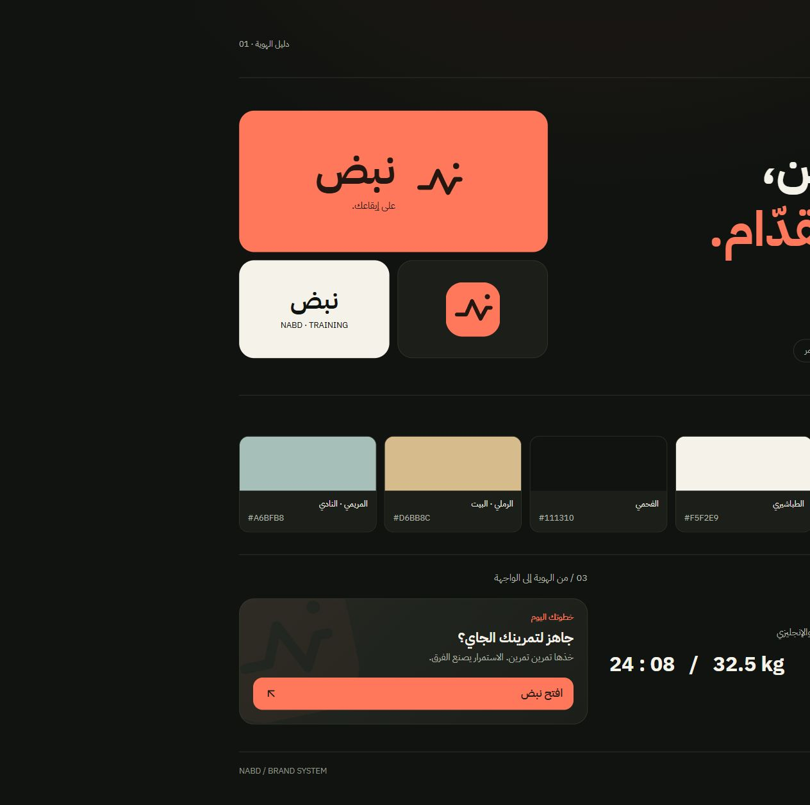

# نبض — على إيقاعك.

نبض رفيق تمرين شخصي بالعربي للبيت والنادي. يساعدك تعرف وش تتمرّن، تسجّل أداءك، وتشوف تقدّمك. الفكرة الأساسية: الاستمرار على إيقاع يناسبك.

## الرسالة والشخصية

- الشعار اللفظي: **على إيقاعك.** / **At your pace.**
- الوعد: **كل تمرين، خطوة لقدّام.** / **Every workout. A step forward.**
- الوصف: خطة واضحة. تمرين بتركيز. وتقدّم تشوفه.
- الشخصية: واضحة، عملية، هادئة ومشجّعة. نتكلم مع شخص يتمرّن، ونعطيه الخطوة التالية مباشرة.
- النبرة: عربي سعودي خفيف ومفهوم. «كمّل التمرين»، «خطوتك اليوم»، «خذها تمرين تمرين». بلا لوم أو مبالغة أو وعود بنتائج جسمانية.

## العلامة

المصدر المعتمد: `public/brand/symbol.svg`. خط صاعد وهابط يعبّر عن الإيقاع والحركة، ونقطة منفصلة تعطيه توقيعًا مميزًا. المربع المرجاني بحواف مستديرة هو حاوية العلامة.

المكوّنان `Brand` و`BrandMark` هما طريقة عرضها داخل الواجهة. الاسم يكتب «نبض» بالعربي و«Nabd» بالإنجليزي. المسافة الحرة حول العلامة لا تقل عن ربع عرضها. أصغر حجم للعلامة داخل الواجهة 24 بكسل. حافظ على نسبها واتجاهها؛ لا تعكسها مع اتجاه اللغة. النسخة الزخرفية وحدها يمكن تدويرها بشفافية منخفضة.

الأيقونة ونسخ التثبيت تولّد من المصدر نفسه عبر `npm run icons`. نسخة maskable لها خلفية مرجانية كاملة ومحتوى داخل المنطقة الآمنة.

## الألوان

| اللون | القيمة | الاستخدام |
| --- | --- | --- |
| الفحمي | `#111310` | خلفية التطبيق |
| السطح | `#1B1E19` | البطاقات |
| السطح المرتفع | `#252922` | عناصر التحكم |
| الطباشيري | `#F5F2E9` | النص الأساسي |
| المرجاني | `#FF785C` | العلامة والإجراء الأساسي والتحديد الحالي |
| الحبر | `#241610` | النص فوق المرجاني |
| الرملي | `#D6BB8C` | البيت |
| المريمي | `#A6BFB8` | النادي |
| الأخضر | `#A4CF9A` | الإنجاز والنجاح |

المرجاني هو اللون الأساسي الوحيد. ألوان المكان ثانوية، والتنبيهات لها ألوانها الدلالية. استخدم الرموز في `src/styles/index.css` بدل كتابة قيم ثابتة في المكونات.

## الخط والتكوين

**IBM Plex Sans Arabic** للعربية والإنجليزية، مستضاف محليًا ويعمل دون اتصال. وزن 700 للعناوين والأرقام، 600 للإجراءات، و400/500 للنصوص. لا تضف تباعد حروف إلى العربية. فعّل الأرقام الجدولية للأوزان والمؤقتات.

البطاقات بزوايا 22 بكسل تقريبًا وعناصر التحكم 14 بكسل، مع حدود خفيفة وظلال محدودة. مسافات مبنية على 4 بكسل، وهوامش شاشة 20–24 بكسل. إجراء أساسي واضح لكل حالة. الحركة قصيرة ووظيفية وتحترم تقليل الحركة.

استخدم خصائص الاتجاه المنطقية لتعمل الواجهة بالعربي والإنجليزي. الواجهة هادئة بما يكفي لقراءة الأوزان وتسجيل المجموعات بسرعة.

## أماكن التطبيق

الهوية مطبقة على شاشة البداية، رأس الشاشات الرئيسية، بطاقة التمرين، شريط التنقل، البطاقات المشتركة، الإعدادات، وأيقونات المتصفح والتثبيت. لوحة الهوية متاحة أثناء التطوير على `/dev/brand`.
