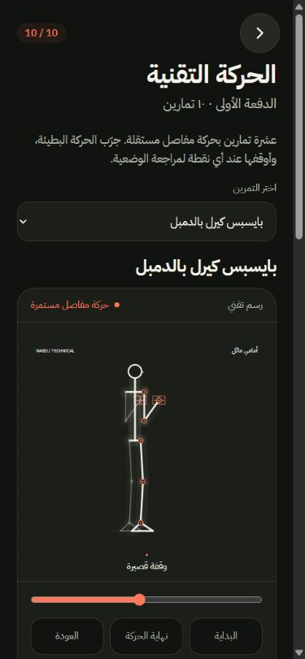

# الدفعة الأولى — عشرة تمارين بحركة مفاصل مستمرة

الحالة: مفعّلة في صفحات التمارين، نافذة شرح التمرين أثناء الجلسة، والصور المصغرة. صفحة المراجعة `/motion-batch`. الأعداد الحالية: 10 تمارين بحركة مستمرة، 439 تمرينًا بوضعيات المصدر، و17 نشاطًا برموز ثابتة.

آخر تحديث: [مراجعة الدفعة وتصحيح الارتكاز والتعليمات](BATCH-01-REVIEW.md). الفحص التقني ناجح؛ مراجعة مدرب مؤهل لم تتم بعد.

[المعاينة الأحدث بعد المراجعة](motion/nabd-continuous-batch-01-reviewed.mp4) — النسخة الأقدم أدناه محفوظة للمقارنة.

## التمارين والمرجع

| التمرين | المعرّف الدقيق | مرجع الحركة |
| --- | --- | --- |
| سكوات بوزن الجسم | `6YUfHPL` | [ACE: Bodyweight squat](https://www.acefitness.org/resources/everyone/exercise-library/135/bodyweight-squat/) |
| الضغط | `I4hDWkc` | [ACE: Push-up](https://www.acefitness.org/resources/everyone/exercise-library/41/push-up/) |
| سبليت سكوات بوزن الجسم | `9E25EOx` | [ACE: Forward lunge](https://www.acefitness.org/resources/everyone/exercise-library/94/forward-lunge/) للوقفة السفلية؛ خطوات الكتالوج للوقفة المنفصلة الثابتة |
| جسر الأرداف | `glute-bridge` | [ACE: Glute bridge](https://www.acefitness.org/resources/everyone/exercise-library/49/glute-bridge/) |
| رفع السمانة بوزن الجسم | `bJYHBIN` | [ACE: Standing calf raises — wall](https://www.acefitness.org/resources/everyone/exercise-library/73/standing-calf-raises-wall/) |
| كيرل الدمبل واقفًا | `NbVPDMW` | [ACE: Dumbbell biceps curl](https://www.acefitness.org/resources/everyone/exercise-library/44/seated-biceps-curl/) للمرفق والرسغ؛ وضع الوقوف من الكتالوج |
| السحب العلوي بالكيبل | `RVwzP10` | [ACE: Seated lat pulldown](https://www.acefitness.org/resources/everyone/exercise-library/158/seated-lat-pulldown/) |
| التجديف جالسًا بالكيبل | `fUBheHs` | [ACE: Seated row](https://www.acefitness.org/resources/everyone/exercise-library/168/seated-row/) للمرفق والجذع؛ الكيبل من نسخة الكتالوج |
| ضغط الكتف جالسًا بالدمبل | `3d7wHyd` | [ACE: Seated shoulder press](https://www.acefitness.org/resources/everyone/exercise-library/186/seated-shoulder-press/) لمسار الضغط ودعم الظهر؛ الدمبل من نسخة الكتالوج |
| البنش بالدمبل | `SpYC0Kp` | [ACE: Chest press](https://www.acefitness.org/resources/everyone/exercise-library/19/chest-press/) |

هذه هياكل تعليمية أصلية، بمدى حركة توضيحي، وليست بيانات التقاط حركة أو قياسات سريرية. لا تعرض زوايا مفاصل بوصفها أهدافًا طبية. تمت مراجعة الأوضاع الأساسية مع المراجع وخطوات التمرين، دون ادعاء مراجعة بشرية من مختص.

## ما تغير

نقاط مفاصل ثلاثية الأبعاد تُسقط على منظور مناسب لكل تمرين. المحرك يحافظ على أطوال الأطراف ويحل وضع المرفق والركبة رياضيًا، ويعيد حساب الشكل من الزمن نفسه عند التقديم والترجيع. لا تبديل صور أو مزج بين وضعيتين. يظهر الدمبل والبنش والكيبل ودعم الحائط عند الحاجة.

المشغل: تشغيل وإيقاف، سرعة 0.5× أو 1×، شريط تحريك يدوي، وقفز للبداية أو نهاية الحركة أو العودة. يحترم تقليل الحركة ويوقف الساعة خارج الشاشة وعند إخفاء الصفحة. مدة الدورة التوضيحية ست ثوانٍ.

الربط بالمعرّف وحده؛ مثال: السبليت سكوات بالدمبل المرفوع (`qx4fgX7`) لا يستخدم حركة السبليت سكوات بوزن الجسم رغم اشتراكهما في اسم ملف رسم.

## المصدر والتصدير

- `src/motion/engine.ts`: النماذج والهندسة والربط والمراجع.
- `src/motion/svgRenderer.ts`: الرسم المستخدم في التطبيق وقصّة.
- `src/motion/standalone.ts`: ساعة الرسوم الخاصة بقصّة.
- `npm run motion:build`: بناء النسخة المستقلة باستخدام esbuild الموجود في تثبيت Edit-tool. يمكن تحديد التثبيت بمتغير `NABD_EDIT_TOOL`.
- `node scripts/build-motion-rigs.mjs --studio`: مزامنة الرسم إلى مشروع قصّة الحالي. لا تُعد المزامنة فوق تعديلات المستخدم دون مراجعتها.
- `studio/edit-data/projects/nabd-rig-batch-01/`: مشروع قصّة، مستقل عن عينات الستايل القديمة. إعداد التايملاين تم عبر MCP.
- [معاينة فيديو 60 ثانية](motion/nabd-continuous-batch-01.mp4): 720×720، 24fps، عشر حركات متتالية، رندر من قصّة للمراجعة.
- [تعريف الدفعة](motion/rig-batch-manifest.json).

## التحقق

- 128 اختبارًا ناجحًا وبناء الإنتاج ناجح. يبقى تحذير حجم حزمة التطبيق الموجود سابقًا.
- ثبات أطوال كل الأطراف عبر 181 عينة زمنية لكل تمرين، والعودة إلى وضع البداية عند نهاية الدورة.
- ثبات ارتكاز اليدين والقدمين في الضغط، وثبات أصابع القدم مع ارتفاع الكعب، وثبات المرفق والذراع العلوي في الكيرل.
- اختبار ربط نسخ التمرين، الإيقاف بعد التحريك اليدوي، والمشغل على الجوال داخل المتصفح.
- اختبار صفحة الكيرل الفعلية: المحرك الصحيح يعمل دون أخطاء في سجل المتصفح.
- مراجعة بصرية في قصّة للعشرة، ثم رندر معاينة مكتمل: 1,440 إطارًا خلال 60 ثانية. `render_preflight` جاهز دون موانع أو تحذيرات. ملاحظة `review` عن غياب صورة V1 لا تحتسب طبقات الرسوم؛ المعاينة تؤكد ظهور التكوينات.

