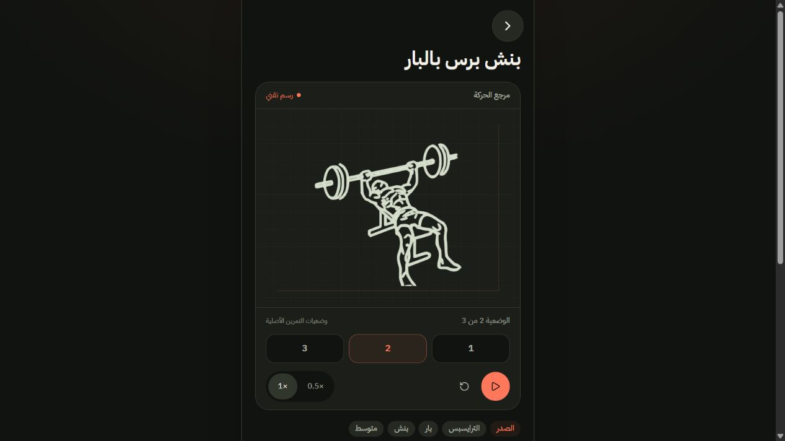

# الرسم التقني — الاتجاه المعتمد لنبض

اعتمد المستخدم الرسم التقني في 10 نوفمبر 2026. التطبيق يستخدم الآن معالج عرض واحدًا للرسوم في المكتبة، شرح التمرين، نافذة معلوماته، واختيار التمارين وشاشة الجلسة.

**تحديث الدفعة الأولى:** أصبحت عشرة تمارين تملك هياكل مفاصل مستمرة مستقلة ومفعّلة في المنتج. [تفاصيل الدفعة ومراجعها](CONTINUOUS-BATCH-01.md).

**تحديث الدفعة الثانية (11 نوفمبر 2026):** خمسة تمارين إضافية — سكوات بالبار، ديدلفت روماني، رفع جانبي، عقلة بقبضة معكوسة، بوش داون. [التفاصيل](CONTINUOUS-BATCH-02.md). الوضع الحالي: 15 بحركة مستمرة، 434 بعرض وضعيات المصدر، و17 نشاطًا برموز ثابتة. المشغّل صار فيه أدوات شرح (وهج العضلات، مسار الحركة، نهاية المدى، التنفّس، شريط الإيقاع) — [تحسين التجربة](UX-UPGRADE-01.md).

**تحديث الدفعة الثالثة (11 نوفمبر 2026):** بنش برس بالبار، تجديف منحني، ضغط عسكري واقفًا، كيرل بالبار، وليج كيرل. [التفاصيل](CONTINUOUS-BATCH-03.md). الوضع الحالي: 20 بحركة مستمرة، 429 بعرض وضعيات المصدر، و17 نشاطًا برموز ثابتة.

## ما نُفّذ

- 449 تمرينًا يستخدم 388 ملف رسوم أصليًا، بإجمالي 1,076 وضعية. المعالجة: خطوط فاتحة عالية التباين على سطح داكن وشبكة خفيفة ولمسات مرجانية.
- 17 نشاطًا رياضيًا لا يحتوي المصدر على وضعيات له؛ أضيف لكل واحد رمز ثابت خاص به، مع توضيح غياب تسلسل الحركة.
- مشغل وضعيات: تشغيل وإيقاف، سرعة 0.5× أو 1×، اختيار وضعية مباشرة، وإعادة للبداية. الرجوع يمر بالوضعيات الوسطى؛ لا يتلاشى رسمان فوق بعضهما.
- الحركة التلقائية تحترم تقليل الحركة وتوقف عرضها عندما تكون خارج الشاشة أو الصفحة مخفية. المستخدم يستطيع تحريك الوضعيات يدويًا.
- الرسم التقني هو الافتراضي المعتمد في مراجعة العينات أيضًا، مع ترحيل اعتماد العينة القديم إلى الاختيار الذي حدده المستخدم.
- اعتماد المستخدم مسجل بعملية قابلة للتراجع في مشروع قصّة `nabd-motion-styles-v1`، دون حذف العينات الأخرى.

## حدود المحتوى

الرسوم الأصلية لا تحتوي هياكل مفاصل. أضيفت نماذج تعليمية أصلية لعشرة تمارين، لكل منها هندسة مفاصل ومعدّات وحركة مستقلة. الربط بالمعرّف الدقيق للتمرين، فلا ترث النسخ المختلفة حركة خاطئة بسبب اشتراكها في ملف رسم. بقية المكتبة تحتفظ بوضعيات المصدر حتى تجهيز نماذجها الخاصة.

## التحقق

- `npm run art:audit`: 466 سجلًا مغطى، 1,076 مسار وضعية صالحًا، دون أخطاء. التقرير: `docs/motion/technical-coverage.json`.
- `npm test`: 111 اختبارًا ناجحًا. تشمل تغطية الكتالوج، عدم تراكب الوضعيات، الإيقاف بعد الاختيار اليدوي، التشغيل البطيء، ومسار التمرين حتى الحفظ.
- `npm run build`: ناجح. يبقى تحذير Vite الخاص بحجم الحزمة الرئيسية.
- مراجعة بصرية للبنش والديدلفت ورمز كرة القدم والمكتبة، مع اختبار اختيار وضعية يدويًا في المتصفح.

