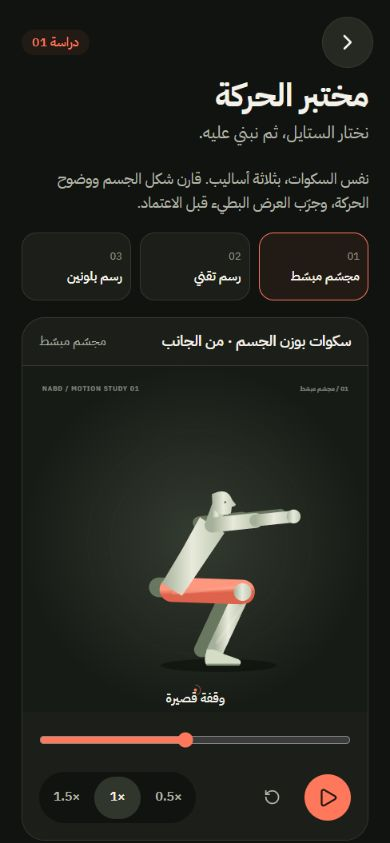

# نبض — دراسة الحركة 01

الحالة الحالية: **اعتمد المستخدم الرسم التقني**، وعُممت المعالجة الخطية على رسوم الوضعيات الأصلية لكل المكتبة. التغطية: 449 تمرينًا له رسوم، و17 نشاطًا رياضيًا برموز ثابتة مخصصة. [تفاصيل التعميم](TECHNICAL-ROLLOUT.md) و[تقرير التغطية](../motion/technical-coverage.json).

**تحديث 11 نوفمبر 2026 — ستايل «أجزاء ملوّنة» (06):** صار الافتراضي للتمارين الـ15 اللي فيها حركة مفاصل مستمرة: أطراف مريمية، الجهة البعيدة أغمق، تيشيرت طباشيري، شورت مرجاني، وحلقات مفاصل مرجانية في المشغّل الكبير فقط. المعالج نفسه في `src/motion/svgRenderer.ts` (`style: 'segments'`)، والرسم التقني باقٍ كخيار `style: 'technical'`. الحركة صارت تنرسم كل إطار بدل 30 إطارًا في الثانية. الإرشادات (المسار ونهاية المدى) مخفية افتراضيًا خلف زر «إرشادات»، ووهج العضلات الشغّالة يظهر بس وقت الجهد. التمارين الـ434 الباقية رسوماتها خطوط مرسومة بدون مفاصل، فما تنقسم لأجزاء ملوّنة. أخذت لون الشخصية الجديد، وصارت تنتقل بين الوضعيات بتلاشٍ ناعم (320ms) بدل القفز.

الستايلات التالية هي سجل العينات التي سبقت الاعتماد. اكتملت الجولة الثانية بأربعة اتجاهات إضافية: شخصية رياضية، خطوط واضحة، أجزاء ملوّنة، وقبل وأثناء. المقاطع السبعة باقية في مشروع قصّة. الاعتماد التقني مسجل هناك في المراجعة 3.

| الاتجاه | الفكرة |
| --- | --- |
| مجسّم مبسّط | شخصية ممتلئة بتظليل خفيف، أطراف منفصلة، ولباس مرجاني. الترشيح المبدئي. |
| رسم تقني | مفاصل ومسار ووضعية بداية مرجعية. |
| رسم بلونين | شكل مسطّح على خلفية طباشيرية بتباين مرتفع. |

## المراجعة

- داخل التطبيق: `/motion-lab`، أو بطاقة «حركة جديدة لنبض» في مكتبة التمارين.
- تحكم: إيقاف وتشغيل، إعادة للبداية، تحريك يدوي، وسرعات 0.5× و1× و1.5×.
- زر اعتماد يحفظ اختيار العينة فقط. يمكن تغييره باختيار اتجاه آخر واعتماده.
- [معاينة فيديو من Edit-tool، 18 ثانية](../motion/nabd-styles-v1.mp4).
- [مقارنة الوضعية نفسها في الاتجاهات الثلاثة](../motion/contact_sheet-nabd-motion-styles-v1.jpg).

## الربط مع Edit-tool / قصّة

المصدر البرمجي للأداة: `D:/AntigravityProjects/Edit-tool`. الاتصال تم عبر عميل MCP الحقيقي في `scripts/edit-tool.mjs`، مع بيانات منفصلة داخل `studio/edit-data` وخادم محلي على المنفذ `14317`.

مشروع المراجعة: `nabd-motion-styles-v1`، ويمكن فتحه على `http://127.0.0.1:14317/?p=nabd-motion-styles-v1` ما دام الخادم يعمل. يضم ثلاثة مقاطع رسوم على مسار «عينات نبض»، ست ثوانٍ لكل مقطع، بهوية نبض. كل تغييرات التايملاين تمت عبر عمليات MCP، لا عبر تعديل `project.json` يدويًا.

المصدر المشترك للحركة: `public/motion/squat/`. `window.renderFrame(t, graphic)` يرسم الوضعية من الزمن مباشرة، لذلك يعمل التقديم والترجيع بدون الاعتماد على تاريخ التشغيل. التطبيق يرسل الزمن إلى الإطار، وقصّة يستخدم ساعة الرندر الأصلية. `scripts/sync-motion-studio.mjs` ينسخ المصدر إلى مجلد الرسوم في مشروع قصّة ويضيف وقت التشغيل الخاص به. لا تعِد المزامنة فوق تعديلات المستخدم داخل المحرر دون مراجعتها وترحيلها أولًا.

إعادة الاتصال: `node scripts/edit-tool.mjs projects_list`. يمكن تغيير مسار تثبيت الأداة بمتغير `NABD_EDIT_TOOL`.

## التحقق

- بناء الإنتاج ناجح.
- 99 اختبارًا ناجحًا، تشمل العودة في الزمن، تطابق الوضعية عند طلبها مجددًا، استمرار الحلقة، تغيّر الستايل واللغة، وحفظ اعتماد العينة دون تغيير إعدادات التمرين.
- مراجعة بصرية للتكوين عبر `graphic_preview` و`contact_sheet` في قصّة، ثم مراجعة التحكم بالأنميشن والستايلات الثلاثة داخل التطبيق على الجوال.
- تصدير معاينة أصلي من قصّة: 720×720، 24fps، 18 ثانية. رقم المراجعة 1.
- `render_preflight` أعاد جاهزية التصدير دون موانع أو تحذيرات. فحص `review` أعطى ملاحظة معلوماتية «صوت فقط» لأنه لا يحتسب الرسوم ضمن تغطية الصورة؛ الفحص البصري والمعاينة المصدرة يظهران الرسوم الثلاثة.

أضيفت الآن [دفعة أولى من عشرة هياكل مفاصل مستمرة](CONTINUOUS-BATCH-01.md)، مع الحفاظ على الوضعيات الأصلية لبقية الكتالوج. المصدر الجديد هو `src/motion/engine.ts` ويستخدم التطبيق وقصّة نفس معالج الرسم، بدون تغيير ملفات المصدر القديمة.
